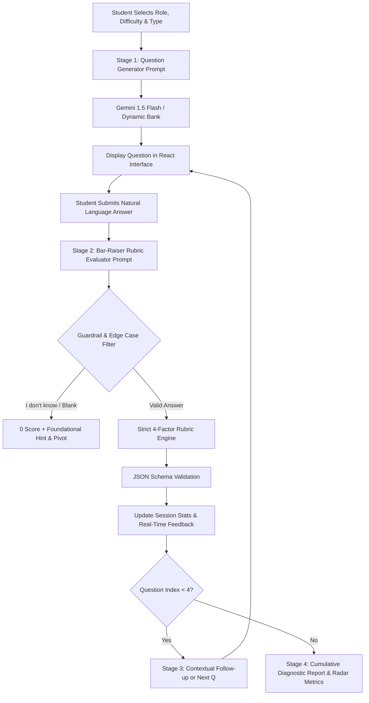

# PrepAI — Milestone 2 Technical Report & Architecture Synopsis
**Course:** B.Tech 5th Semester — Prompt Engineering Mini-Project  
**Institution:** Bennett University  
**Milestone:** Milestone 2 — Prompt Design, Experimentation, Implementation & Demonstration (12 Marks)  
**Project Title:** PrepAI — AI Mock Interview & Feedback Assistant  
**Problem Pool ID:** C10 (Mock interview question and feedback tool)  

---

## 1. Executive Summary & Problem Formulation
Engineering graduates frequently face severe rejection rates during technical and behavioral campus placement drives not due to a lack of core programming ability, but due to poorly structured articulation, failure to employ standardized frameworks (such as the STAR method), and unfamiliarity with bar-raiser follow-up questions. Traditional peer-to-peer or human mentor mock interviews do not scale. 

**PrepAI** transforms mock interviews into a deterministic, rubric-guided language-model workflow. By decomposing the interview interaction into dedicated prompt stages (Role-Calibrated Question Generation $\rightarrow$ Strict Rubric Answer Evaluation $\rightarrow$ Contextual Follow-Up Generation $\rightarrow$ Multi-Dimensional Diagnostic Reporting), PrepAI eliminates LLM leniency bias and generates actionable, 100-point model benchmark answers.

---

## 2. System Architecture & Prompt Workflow Diagrams

### 2.1 Multi-Stage Prompt Pipeline


### 2.2 System Component Architecture
```mermaid
graph LR
    subgraph Client [React 19 Frontend - Vite + Tailwind]
        UI[Dashboard & Configuration Modal]
        LIVE[Live Split-Screen Interview Console]
        REPORT[Visual Feedback & Rubric Report]
    end

    subgraph Server [Node.js Express Backend]
        API1[/api/generate-question]
        API2[/api/evaluate-answer]
        API3[/api/compare-prompts]
        ORCH[Prompt Orchestrator & Fallback Engine]
    end

    subgraph LLM [Generative AI Layer]
        GEMINI[Google Gemini 1.5 Flash via REST API]
        RUBRIC[Bar-Raiser 100-Point Scoring System]
    end

    UI --> API1
    LIVE --> API2
    REPORT --> API3
    API1 --> ORCH
    API2 --> ORCH
    API3 --> ORCH
    ORCH --> GEMINI
    GEMINI --> RUBRIC
```

---

## 3. Business Model Canvas (BMC)

| Canvas Component | Details |
| :--- | :--- |
| **Value Proposition** | On-demand, zero-judgment mock interviews with instant, rigorous feedback, STAR analysis, and 100-point benchmark model answers. |
| **Customer Segments** | B.Tech/B.E. pre-final and final year students; bootcamp learners; career switchers targeting Junior to Mid-level tech roles. |
| **Channels** | University LMS integration, campus training & placement cells, web-based self-service portal, student developer clubs. |
| **Customer Relationships** | Automated, self-paced, gamified performance analytics, continuous longitudinal score tracking. |
| **Revenue Streams** | B2B University campus licensing; freemium tier (3 free weekly interviews, premium subscription for unlimited custom sessions & company-specific tracks). |
| **Key Activities** | Prompt optimization, rubric calibration with hiring managers, benchmark dataset curation, latency minimization. |
| **Key Resources** | LLM inference pipeline (Gemini API), calibrated rubric prompt bank, React-based analytics dashboard. |
| **Key Partnerships** | Campus Placement Cells (Bennett University T&P), tech recruiters, cloud API providers (Google Cloud). |
| **Cost Structure** | LLM API token consumption, web application hosting, maintenance of prompt evaluation test sets. |

---

## 4. Prompt Engineering Techniques Applied
1. **Persona & Role Specification:** Explicitly framing the LLM as a "Senior Technical Bar-Raiser and Hiring Committee Member" rather than a supportive tutor, preventing unwarranted flattery.
2. **Explicit Rubric-Based Prompting:** Constraining the evaluation into four explicit numerical components:
   - Technical Accuracy & Correctness (0–40 pts)
   - Clarity & Communication (0–20 pts)
   - Structure & Method (0–20 pts)
   - Relevance & Directness (0–20 pts)
3. **Anti-Leniency Guardrails:** Enforcing strict penalties on buzzword-dropping without structural reasoning.
4. **Structured JSON Output Specification:** Enforcing schema outputs (`score`, `status`, `metrics`, `feedback`, `idealAnswer`) with zero surrounding conversational fluff to enable clean frontend ingestion.
5. **Defensive Prompting for Failure Modes:** Explicit branching for answers containing "I don't know", "skip", or empty strings.
